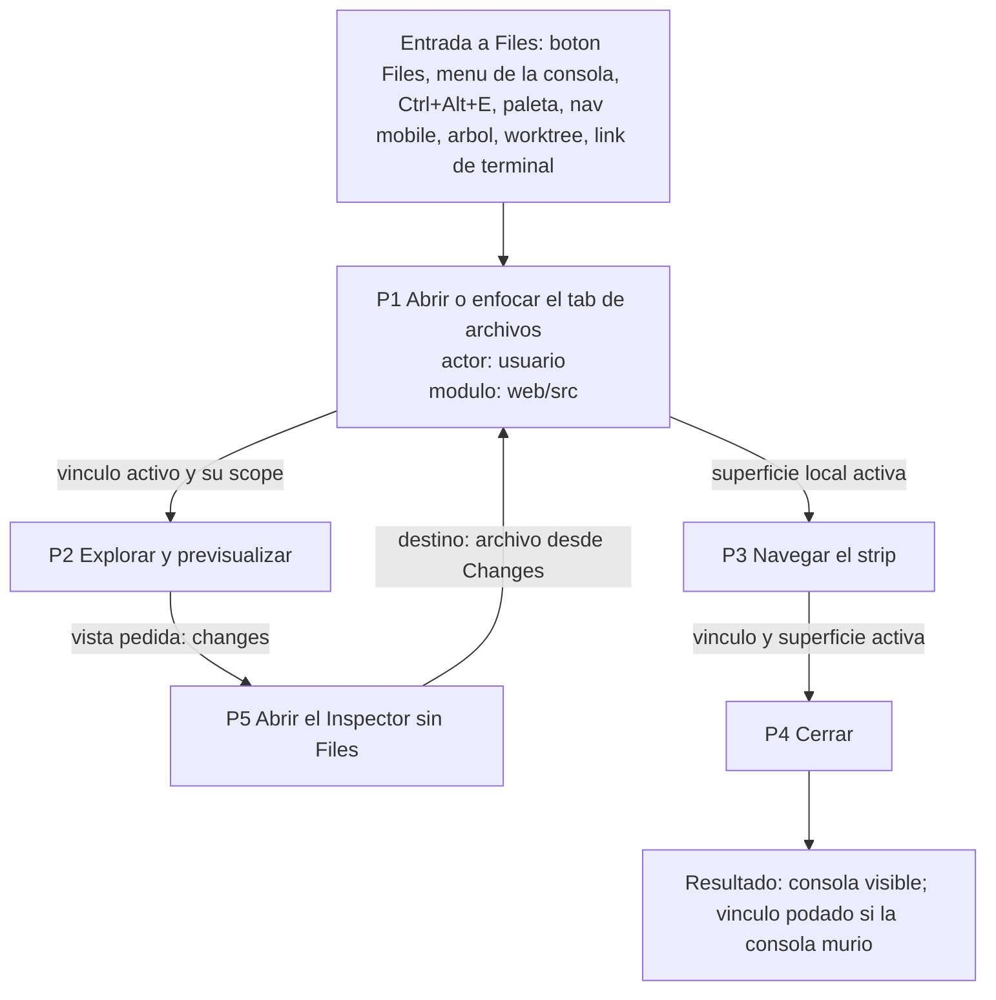

# Pipeline integrador

> Diagrama de procesos encadenados del tab de archivos vinculado. Los bloques entre marcadores salen del modelo; el diagrama y la lectura son de Mary.

## Diagrama

## Tabla resumen

<!-- modelo:start vista=pipeline -->
# Pipeline integrador

Proyectado desde el modelo. No editar: la fuente son las aristas `TRANSICION`.

## Extremos de la cadena

- `PRO_P1_abrir_enfocar` Abrir o enfocar el tab de archivos de la consola activa — inicial
- `PRO_P4_cerrar` Cerrar el tab de archivos o su consola — terminal

## Transiciones

| De | A | Dato que viaja |
|---|---|---|
| PRO_P1_abrir_enfocar | PRO_explorar_archivos | vinculo activo (ownerTabId) y su scope |
| PRO_P1_abrir_enfocar | PRO_P3_navegar_strip | superficie local activa (consola o tab de archivos de una consola) |
| PRO_explorar_archivos | PRO_P5_inspector_sin_files | vista pedida (changes, commits, history) |
| PRO_P5_inspector_sin_files | PRO_P1_abrir_enfocar | destino opcional: archivo o directorio (link, Changes, arbol) |
| PRO_P3_navegar_strip | PRO_P4_cerrar | vinculo (ownerTabId) y superficie activa |

<!-- modelo:end -->

## Branching y bucles

- **Bucle de revision:** P2 -> P5 -> P1. Ver los cambios de un archivo abre el Inspector en Changes (DEC_D8_inspector_changes); abrir un archivo desde Changes cierra el Inspector y vuelve al tab de archivos (DEC_P1_changes_cierra_inspector).
- **Rama de navegacion:** P1 -> P3 cuando el usuario alterna entre la consola y su tab de archivos, o cuando el foco externo cambia la consola (DEC_P3_foco_externo_manda).
- **Cierre externo:** P4 tambien se dispara sin pasar por P3 cuando la consola duena desaparece en un snapshot (INV-09); el pipeline lo modela como el mismo terminal.
- **P5 independiente:** el usuario puede abrir el Inspector directamente (Changes, Commits, History) sin pasar por el tab de archivos; P5 no exige a P2.
