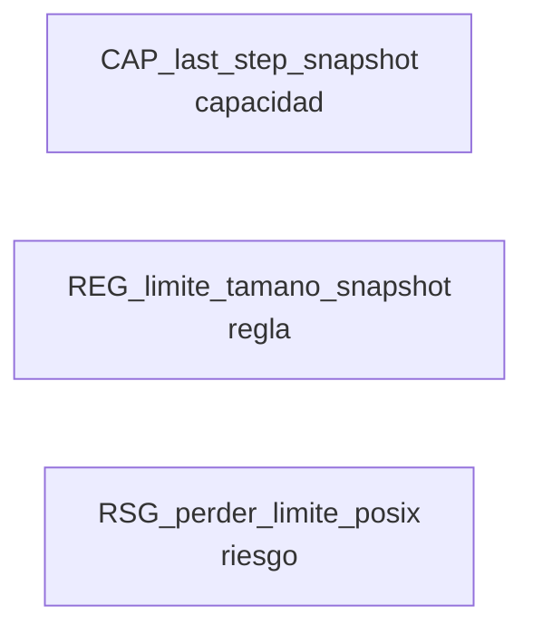

# Work: Last step falla en Windows por ulimit

> Estado: **EN_PROGRESO** · Ruta: bugfix · Modo: normal · Nivel: normal · 2026-10-12

## Objetivo

Corregir los snapshots de Last step en Windows: el script de captura (server/src/workspace/git-snapshot.ts:44) ejecuta `ulimit -f 65536 || fail 'file size limits unavailable'` y en el shell de Git for Windows falla con `ulimit: file size: cannot modify limit: Invalid argument`, rompiendo la vista Last step y 20 pruebas de git-diff.test.ts (FM-12).

## Abordaje (2026-10-12)

Abordaje comprimido (atajo bugfix pedido por el usuario al cerrar 20261012-tab-archivos-vinculado). Evidencia ya recolectada en ese work (FM-12 en post-works): `bun test server/src/workspace/git-diff.test.ts` da 12 pass / 20 fail en este host y todas las fallas son `ulimit: file size: cannot modify limit: Invalid argument`, dentro de snapshotWorktreeTree (server/src/workspace/git-diff.ts ~441). El script de captura vive en server/src/workspace/git-snapshot.ts:44 (`ulimit -f 65536 || fail 'file size limits unavailable'`). Host: Windows 11, Git for Windows sin etc/fstab ni etc/profile (ya visto en T-011). Bug focal en 1-2 archivos de server/src/workspace, sin capacidad nueva. Riesgo a cuidar: el ulimit protege contra snapshots gigantes; el arreglo no puede retirar esa proteccion en Linux/macOS/SSH.

## Terreno

<!-- modelo:start vista=terreno -->
Proyectado desde `modelo.yml` del work. No editar a mano: la fuente es el modelo.

| Nodo | Tipo | Rol | Origen | Cita |
|---|---|---|---|---|
| CAP_last_step_snapshot | capacidad | construye | work:20261012-bugfix-last-step-ulimit#abordaje | sin cita |
| REG_limite_tamano_snapshot | regla | consume | work:20261012-bugfix-last-step-ulimit#abordaje | sin cita |
| RSG_perder_limite_posix | riesgo | consume | work:20261012-bugfix-last-step-ulimit#abordaje | sin cita |

**Frontera** — lo que cruza hacia otros works:

_este modelo se reconstruyo desde la data del work y no tiene frontera derivable_
<!-- modelo:end -->

## Decisiones clave

| Fecha | Etapa | Decision | Resolucion |
|-------|-------|----------|------------|
|       |       |          |            |

## Tareas

| T | Titulo | Status | Verif | Tags |
|---|--------|--------|-------|------|

## Iteraciones

| # | Fecha | Accion | Desde etapa | Hacia etapa | Razon |
|---|-------|--------|-------------|-------------|-------|

## Pausas

| Fecha inicio | Etapa | Razon | Fecha reanudacion |
|--------------|-------|-------|--------------------|

## Archivos modificados

- `server/src/workspace/git-snapshot.ts`
- `server/src/workspace/git-snapshot.test.ts`
- `server/src/workspace/git-shell.ts`
- `server/src/workspace/git-shell.test.ts`
- `docs/ARCHITECTURE.md`

## Cierre

Cerrado el 2026-10-12 como COMPLETADO. Desenlace `correccion_codigo`. Meta cumplida y verificada: en este Windows la vista Last step muestra los cambios del ultimo paso de un agente, y git-diff.test.ts pasa 32/0.

- Causa: MSYS2 no admite limites finitos de RLIMIT_FSIZE y el script de captura es fail-closed; ademas la ruta /cygdrive de alternates no la resolvia el git nativo, y MSYS trunca argumentos de mas de ~8 KiB (el script ya estaba al borde).
- Arreglo: excepcion acotada a MSYS/Cygwin (POSIX sigue fail-closed), alternates con cygpath -m, scripts largos partidos en trozos en Windows, doc actualizada.
- Verificacion: pruebas rojo->verde; en navegador, dos pasos simulados en un repo temporal muestran en Last step solo el cambio del segundo paso.
- Fuera de alcance, en post-works: 10 fallas de git-snapshot.test.ts por limitaciones de Windows en las pruebas (symlinks, nombres NTFS, chmod, timeouts) y core.autocrlf=true del Git del host.

## Diagnostico forense

Atlas, Dim 1 (codigo). Desenlace: `correccion_codigo` (suposicion de plataforma).

- Raiz: el runtime MSYS2 de Git for Windows (3.6.9) no admite limites finitos en RLIMIT_FSIZE; `setrlimit` solo acepta infinito y devuelve EINVAL (`ulimit -f 1` tambien falla; el limite duro es `unlimited`). El script de captura es fail-closed a proposito (`server/src/workspace/git-snapshot.ts:43-44`, contrato en `docs/ARCHITECTURE.md:310`), asi que en Windows ningun snapshot de Last step se completa.
- Evidencia cruda: con el script real, code=1 y stderr `ulimit: file size: cannot modify limit: Invalid argument` / `Last step snapshot refused: file size limits unavailable`. Con el ulimit condicionado a MSYS, code=0 y tree valido; `git-diff.test.ts` pasa de 12/20 a 32/0 en una copia.
- Que protege el ulimit: respaldo del kernel por archivo (32-64 MiB) para lo que el script no acota (copia del indice, listados de ls-files, objetos internos de git). Siguen activos: dd de 8 MiB por archivo, tope de 32 MiB y 10000 archivos, plazo de 9 s y timeout de 10 s con kill.
- Hallazgo secundario dentro de la meta: sin etc/fstab, `pwd -P` da `/cygdrive/c/...` y se escribe en `objects/info/alternates` (`git-snapshot.ts:28,48`); el git.exe nativo no lo entiende (`unable to normalize alternate object path`) y el snapshot no ve los objetos del repo.
- Fuera de alcance (no ulimit): 10 fallas de `git-snapshot.test.ts` por symlinks, nombres invalidos en NTFS, chmod, sparse-checkout y timeouts en Windows.

## Solucion

Acordado con el usuario (opcion A + alternates + verificar):
1. `git-snapshot.ts`: si `ulimit -f` falla solo en MSYS/Cygwin (uname MINGW*/MSYS*/CYGWIN*), continuar; en cualquier otro sistema el fail-closed no cambia.
2. Escribir la ruta de `objects/info/alternates` en forma que el git nativo entienda en MSYS (`cygpath -m` cuando exista).
3. `docs/ARCHITECTURE.md:310` declara la excepcion de Windows.
4. Pruebas: rojo->verde en git-diff.test.ts y git-snapshot.test.ts por la causa ulimit; prueba nueva que fije el fail-closed fuera de MSYS y otra para la ruta de alternates.
5. Verificacion en navegador: la vista Last step muestra los cambios reales del ultimo paso de un agente en este Windows.
