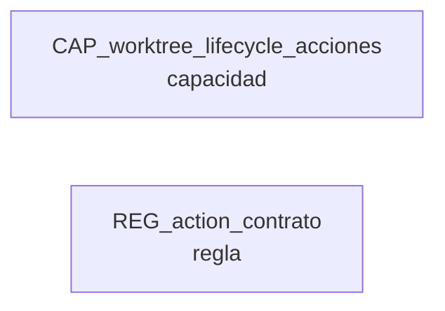

# Work: Worktree Lifecycle oculta el error real de Herdr

> Estado: **EN_PROGRESO** · Ruta: bugfix · Modo: normal · Nivel: normal · 2026-10-12

## Objetivo

Que el dialogo Worktree Lifecycle muestre el error real cuando Herdr rechaza una operacion (abrir, Files, Changes, Remove de un worktree), en vez del mensaje generico 'Herdr opened the checkout without returning a workspace ID' (FM-16).

## Abordaje (2026-10-12)

Abordaje comprimido (atajo bugfix, FM-16 de post-works, detectado en T-013 de 20261012-tab-archivos-vinculado). Evidencia: action() (web/src/store.ts:1957-2031) captura el rechazo de la llamada, lo guarda en state.error via setForConnection y devuelve undefined. openWorktree/openWorktreeFromCwd (store.ts:3241-3285) devuelven ese undefined; WorktreeLifecycleDialog.tsx:381 y :410 (openWorktreeResource y removeWorktree) convierten undefined en 'Herdr opened the checkout without returning a workspace ID'. Visto en navegador durante T-013: el error real era worktree_not_found: worktree branch not found (dev-server4.log:31-32) y el dialogo mostraba el generico. Bug focal en 1-3 archivos del cliente; action() tiene 37 llamadores, cuidar no cambiar su contrato para los demas.

## Terreno

<!-- modelo:start vista=terreno -->
Proyectado desde `modelo.yml` del work. No editar a mano: la fuente es el modelo.

| Nodo | Tipo | Rol | Origen | Cita |
|---|---|---|---|---|
| CAP_worktree_lifecycle_acciones | capacidad | construye | work:20261012-bugfix-worktree-error-real#abordaje | sin cita |
| REG_action_contrato | regla | consume | work:20261012-bugfix-worktree-error-real#abordaje | sin cita |

**Frontera** — lo que cruza hacia otros works:

_este modelo se reconstruyo desde la data del work y no tiene frontera derivable_
<!-- modelo:end -->

## Decisiones clave

| Fecha | Etapa | Decision | Resolucion |
|-------|-------|----------|------------|
|       |       |          |            |

## Tareas

| T | Titulo | Status | Verif | Tags |
|---|--------|--------|-------|------|

## Iteraciones

| # | Fecha | Accion | Desde etapa | Hacia etapa | Razon |
|---|-------|--------|-------------|-------------|-------|

## Pausas

| Fecha inicio | Etapa | Razon | Fecha reanudacion |
|--------------|-------|-------|--------------------|

## Archivos modificados

- `web/src/store.ts`
- `web/src/store.test.ts`
- `web/src/components/WorktreeLifecycleDialog.tsx`

## Cierre

Cerrado el 2026-10-12 como COMPLETADO. Desenlace `correccion_codigo`. Meta cumplida y verificada en navegador: cuando Herdr rechaza abrir un worktree, el dialogo Worktree Lifecycle muestra el error real en el detalle de la operacion y aparece un toast 'Failed to open worktree' con el mismo detalle, tambien desde Open existing (antes silencioso). El contrato de action() no cambia para sus 37 llamadores (opcion rethrow explicita, con prueba de control).

- Fuera de alcance, en post-works: action() no limpia state.error al tener exito, y el patron undefined + state.error en otros llamadores.

## Diagnostico forense

Atlas, Dim 1 (codigo cliente). Desenlace: `correccion_codigo`.

- D1: `action()` (web/src/store.ts:2005-2018) atrapa el rechazo, escribe `state.error` y devuelve undefined. `openWorktree`/`openWorktreeFromCwd` (store.ts:3241-3284) no tienen `failureNotice`, a diferencia de createWorktree (3232), removeWorktree (3371), gitPullWorkspace (3054) y setWorkspaceAutoSyncEnabled (3417). El dialogo (WorktreeLifecycleDialog.tsx:374-383, :404-412) convierte undefined en "Herdr opened the checkout without returning a workspace ID" y runOperation (:313-325) muestra ese generico.
- D2: la rama `result === undefined` de runOperation (WorktreeLifecycleDialog.tsx:289-299) llama `store.refresh()`, cuyo patch exitoso pone `error: null` (store.ts:1368), y despues lee `store.get().error`, que ya es null: siempre queda "${label} failed".
- `state.error` solo se pinta en el estado vacio de la terminal (TerminalView.tsx:3139-3141) y en AssistantPanel.tsx:997; el modal (z-index 5000) lo tapa. Los toasts (z-index 6001) si pasan por encima.
- Silencio total hoy: Open de la fila y WorktreeOpenDialog (sin failureNotice y con refresh en onClose).

## Solucion

Acordado con el usuario (A + C + D2):
1. A: opcion `rethrow` en `action()` (por defecto false): tras registrar el error, lo relanza; con la conexion pausada lanza "Connection is paused"; decision explicita para el lease muerto. openWorktree/openWorktreeFromCwd la exponen y el dialogo de lifecycle la usa en Files/Changes/Remove/Open. WorktreeOpenDialog no la usa (dispara sin esperar).
2. C: `failureNotice` "Failed to open worktree" en openWorktree y openWorktreeFromCwd.
3. D2: runOperation captura el error antes de `store.refresh()`.
4. El mensaje "without returning a workspace ID" queda solo para una respuesta exitosa sin workspace.
5. Pruebas rojo->verde en store.test.ts (rechazo con rethrow, notice, control sin rethrow, conexion pausada) y verificacion en navegador provocando un worktree_not_found.
