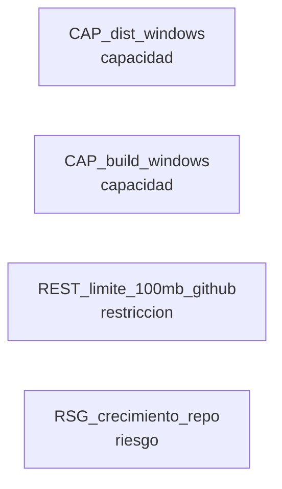

# Work: Dist Windows de Roamgate dinamicapps

> Estado: **EN_PROGRESO** · Ruta: acotado · Modo: normal · Nivel: normal · 2026-10-12

## Objetivo

Publicar nuestra version de Roamgate (fork dinamicapps, rama dev) como dist Windows en GitHub para los devs, siguiendo el patron de los otros *-dist, y empezar a usarla en esta maquina.

## Abordaje (2026-10-12)

Evidencia: (1) compilado actual en E:\DinamicAPPS\roamgate-windows-x64 = roamgate.exe upstream 0.7.8 + VERSION ('roamgate 0.7.8 windows-x64') + roamgate-tailscale.cmd con IP fija 100.82.222.117:8787. (2) Patron de dist: E:\DinamicAPPS\github\claude-mcp-bridge-launcher-dist = README, VERSION-<artefacto> (artefacto, version, sha, bundle, publicado), bin/, install.ps1/install.sh copiados desde scripts/instalador/ del repo fuente por scripts/publicar.ts; commit 'launcher vX (sha)' y tag por version. (3) Roamgate trae build:windows-x64 (bun build --compile); el fork esta en 0.7.15. (4) El .exe compilado pesa 108,6 MB (> 100 MB limite de GitHub); en zip 45,8 MB. (5) gh no instalado; git-lfs disponible. Decisiones del usuario: una sola carpeta E:\DinamicAPPS\roamgate-dist que es el clon del repo dist (uso y publicacion desde ahi); version 0.7.15-dinamicapps.1 con tags roamgate-v0.7.15-dinamicapps.1; lanzador configurable (IP Tailscale si existe, si no localhost; puerto por variable); convivir en 8789 con el v0.7.8 de 8787; binario como zip commiteado en bin/ y extraido por install.ps1 (el .exe en .gitignore); el usuario creo el repo vacio git@github.com:dinamicapps/roamgate-dist.git (verificado accesible y vacio).

## Terreno

<!-- modelo:start vista=terreno -->
Proyectado desde `modelo.yml` del work. No editar a mano: la fuente es el modelo.

| Nodo | Tipo | Rol | Origen | Cita |
|---|---|---|---|---|
| CAP_dist_windows | capacidad | construye | work:20261012-dist-windows-roamgate#abordaje | sin cita |
| CAP_build_windows | capacidad | consume | work:20261012-dist-windows-roamgate#abordaje | sin cita |
| REST_limite_100mb_github | restriccion | consume | work:20261012-dist-windows-roamgate#abordaje | sin cita |
| RSG_crecimiento_repo | riesgo | consume | work:20261012-dist-windows-roamgate#abordaje | sin cita |

**Frontera** — lo que cruza hacia otros works:

_este modelo se reconstruyo desde la data del work y no tiene frontera derivable_
<!-- modelo:end -->

## Decisiones clave

| Fecha | Etapa | Decision | Resolucion |
|-------|-------|----------|------------|
|       |       |          |            |

## Tareas

| T | Titulo | Status | Verif | Tags |
|---|--------|--------|-------|------|

## Iteraciones

| # | Fecha | Accion | Desde etapa | Hacia etapa | Razon |
|---|-------|--------|-------------|-------------|-------|

## Pausas

| Fecha inicio | Etapa | Razon | Fecha reanudacion |
|--------------|-------|-------|--------------------|

## Archivos modificados

- `bun.lock`
- `herdr-plugin.toml`
- `package.json`
- `scripts/instalador/README.md`
- `scripts/instalador/gitattributes-dist`
- `scripts/instalador/gitignore-dist`
- `scripts/instalador/install.ps1`
- `scripts/instalador/install.sh`
- `scripts/instalador/roamgate.cmd`
- `scripts/publicar-dist.test.ts`
- `scripts/publicar-dist.ts`
- `server/package.json`
- `web/package.json`

Repo dist (E:/DinamicAPPS/roamgate-dist, dinamicapps/roamgate-dist): `bin/roamgate-windows-x64.zip`, `VERSION-roamgate`, `install.ps1`, `install.sh`, `roamgate.cmd`, `README.md`, `.gitignore`, `.gitattributes`.

## Cierre

Cerrado el 2026-10-12 como COMPLETADO. Meta cumplida: E:/DinamicAPPS/roamgate-dist es el clon de dinamicapps/roamgate-dist; `git pull` + `.\install.ps1` deja roamgate.exe 0.7.15-dinamicapps.2 y `roamgate.cmd` arranca en la IP de Tailscale (o 127.0.0.1) con puerto configurable. En esta maquina corre en 8789 junto al v0.7.8 de 8787.

- Publicaciones: roamgate-v0.7.15-dinamicapps.1 (53f7037) y roamgate-v0.7.15-dinamicapps.2 (0904923), desde scripts/publicar-dist.ts.
- El .exe (103,6 MB) supera el limite de 100 MB de GitHub y viaja como zip de 43,7 MB que el instalador extrae.
- La version nueva exige ROAMGATE_PASSWORD de 15+ caracteres: el instalador avisa y el README lo explica (T-005). En esta maquina el proceso de 8789 usa una contrasena generada que se entrego al usuario; la variable de maquina no se toco.
